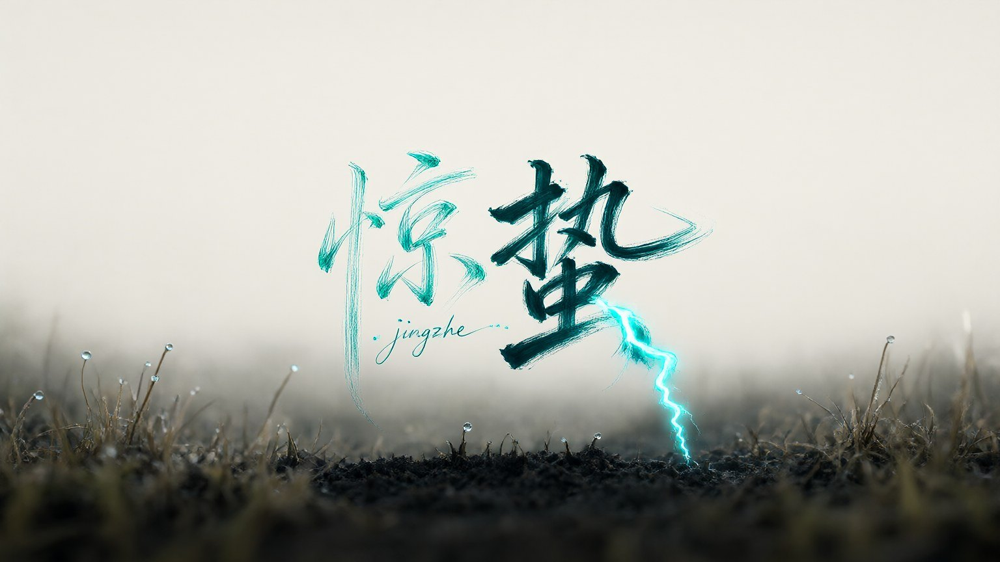
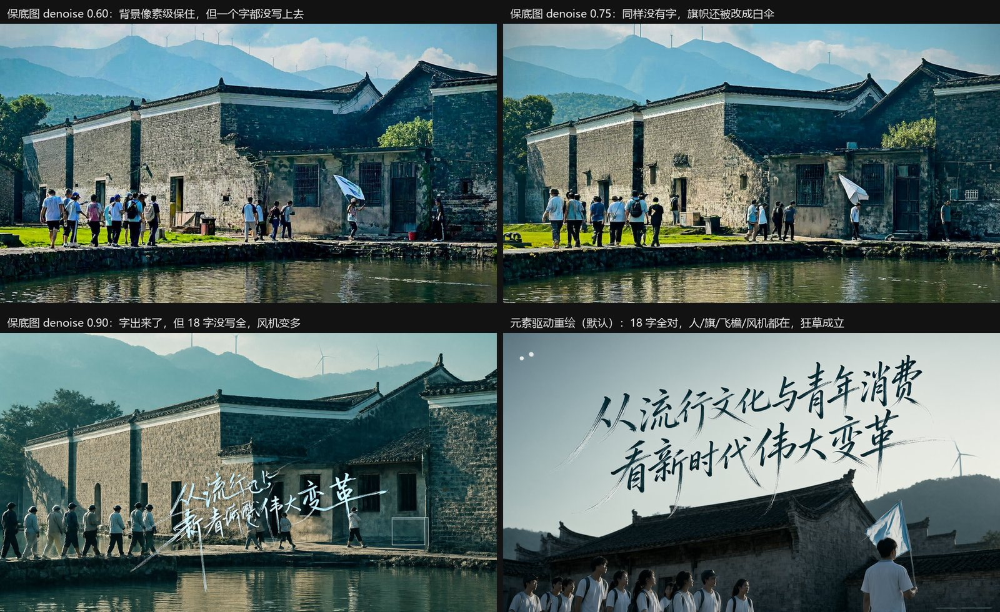
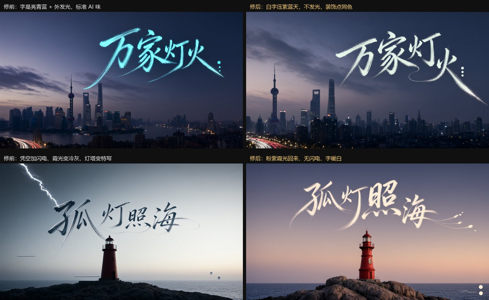
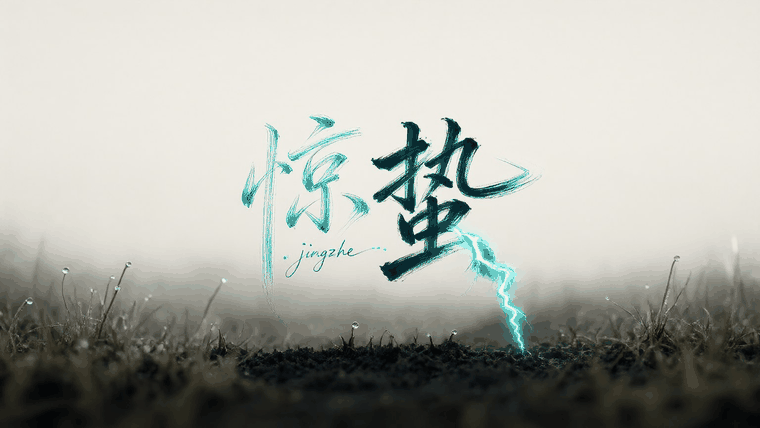
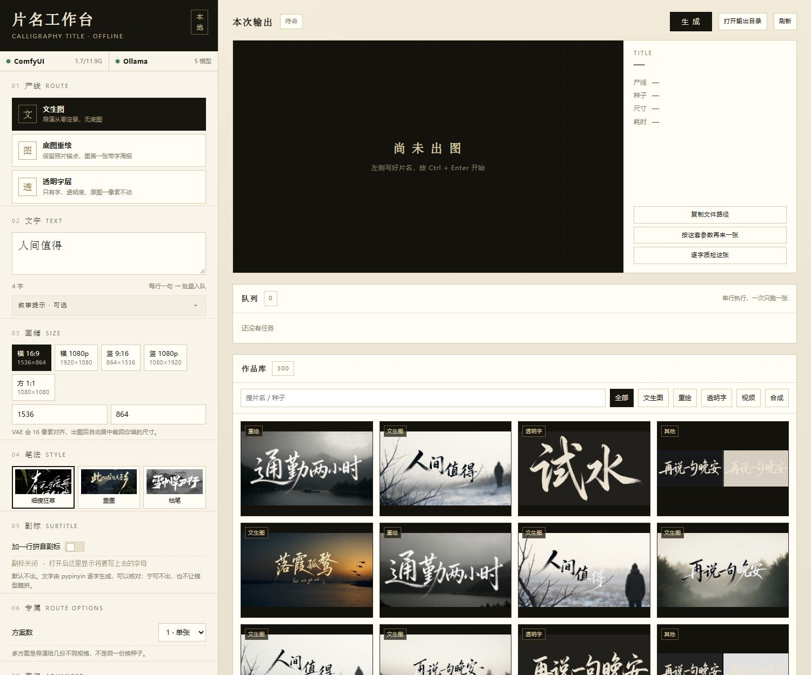

<div align="center">

# 把片名写成一场狂草

**calligraphy-title-poster** · 本地中文书法片名海报生成

把任意片名、诗句或短句，做成一整幅狂草书法海报：本地 Ollama 大模型先读文化、定景、定字，再由本地 ComfyUI 一次性出图。不用现成字体，不做模板填空。


[在线作品集](https://bcntj02z4lod.doubao.link/app/app_17jmhwug309) · [快速开始](#快速开始) · [实测结果](#实测结果) · [已知限制](#已知限制)

</div>



<p align="center"><em>惊蛰 · 文生图 single · Qwen-Image 2.1 turbo · seed 325399</em></p>

> 我想要的不是“给照片加一行字”，是一眼看上去像有人真的提笔写过——字有飞白，景有雾气，整幅读得出，且只有这个片名成立。

## 这是什么

一个完全本地运行的中文书法片名生成系统。它解决的不是“能不能生成字”，而是“怎么让生成的字不像生成的”：

- **字形**：要细劲、缠绕、有飞白与提按，不要纯白实心美术字；
- **景**：要雾气、颗粒、前后层次，不要平滑贴图；
- **构图**：要留白和气口，不要把画面撑满；
- **唯一性**：这个景必须只有这个片名才成立，换个片名还成立就是失败。

系统由两段组成：`qwen3.5:35b` 当导演，输出结构化设计书；`Qwen-Image 2.1 turbo` 当画师，按设计书 8 步出图。前者负责判断，后者负责执行，显存按阶段独占。

## 三条产线

| 产线 | 输入 | 输出 | 单张耗时 | 适用场景 |
|---|---|---|---|---|
| **文生图** `single` | 一句片名 | 整幅海报 | 48–226 s | 还没有画面，只要一张成品海报 |
| **底图重绘** `redraw` | 一张实拍照片 + 片名 | 重画后的海报 | 21–132 s | 已有照片，要求人物/建筑/旗帜等元素留住 |
| **透明字层** `alpha` | 一句片名 | RGBA 透明字层 | 8–15 s | 照片一像素都不想动，字层后期摆 |

底图重绘不是“在原图上叠字”，而是先读懂元素清单，再用空 latent 重画一张——这条路线是被三档 denoise 的失败实验逼出来的：



<p align="center"><em>左：保底图 + denoise 0.60 / 0.75 / 0.90，前两档不出字，0.90 字不全；右：元素驱动重绘，18 字全对</em></p>



<p align="center"><em>字色与发光问题的修复对照</em></p>

详见 [docs/architecture.md](docs/architecture.md)。

## 实测结果

最硬的一组数据来自 14 个用例、78 个字的批量重绘：14 个不同场景，固定流程、不挑图，逐张人眼核对；仅 1 例因多写一个字重跑一次（见下）。

| 指标 | 结果 | 口径 |
|---|---|---|
| 一次成功率 | **92.9%**（13 / 14） | 字全对 + 不发光 + 无崩坏 |
| 目标字正确率 | **100%**（78 / 78） | 逐字计，无缺字错字 |
| 发光率 | **0 / 14** | 无荧光、无外发光、无霓虹 |
| 锚点保留率 | **97.8%**（45 / 46） | 仅丢“大漠孤烟直”的一缕烟 |

透明字层另跑 5 个用例（2–18 字，共 41 字），41/41 正确；tint 清底后，1920 画布全透明占比从 4.5% 升到 87.6%。

完整逐例数据见 [benchmark/results.csv](benchmark/results.csv)，测试设计见 [docs/benchmark.md](docs/benchmark.md)。



<p align="center"><em>12 张示例轮播（4 帧，非实时录屏）；单张与 seed 见 <a href="examples/">examples/</a></em></p>

## 快速开始

### 0. 你需要什么

| 组件 | 要求 |
|---|---|
| GPU | 12 GB 显存起（实测 RTX 5070 Ti Laptop / 12 GB） |
| ComfyUI | 0.45.0+，需含 `comfy_extras.nodes_qwen`，**不需要自定义节点** |
| 绘图模型 | Qwen-Image 2.1 turbo（int8）+ Qwen3-VL 8B 文本编码器 + 对应 VAE |
| 导演 | 本地 Ollama `qwen3.5:35b`（约 22 GB）；`qwen3.5:9b` 可选兜底 |
| Python | 3.10+，依赖 `Pillow`、`requests`、`pypinyin` |

模型文件清单、放置目录与下载说明见 [docs/models.md](docs/models.md)。本仓库**不包含任何模型权重**。

### 1. 安装

```bash
git clone https://github.com/<your-name>/calligraphy-title-poster.git
cd calligraphy-title-poster
python -m pip install -r requirements.txt
```

### 2. 自检

```bash
python src/preflight.py          # 人类可读报告，缺什么直接给修复命令
python src/preflight.py --fix    # 自动建目录、同步笔法参考图
```

自检覆盖：ComfyUI / Ollama 是否在线、节点是否存在、三个模型是否可见、参考图、依赖库、GPU。

### 3. 出图

```bash
python src/run.py 惊蛰                      # 横版单张（整齐版）
python src/run.py 末班地铁 --vertical        # 竖版
python src/run.py 凡尘 --combo 4             # 一次出 4 套方案
python src/run.py 标题 --base 照片.jpg        # 底图重绘
python src/run.py 试水 --alpha               # 透明字层
python src/run.py 落霞孤鹜 --subtitle         # 加拼音副标（默认不出）
python src/run.py 惊蛰 --style ink           # 浓淡版：字内提按、同色浓淡
python src/run.py 稻花香里说丰年 --base web_rice.png --style ink
```

两种版式接口，按需选：

| `--style` | 版式 | 特征 |
|---|---|---|
| `neat`（默认） | 整齐版 | 细劲、缠绕、整组同亮度，长句最稳 |
| `ink` | 浓淡版 | 字内提按、重按同色更浓、干笔更透；更像真迹 |

`--ink-rhythm` 保留为旧写法，等价于 `--style ink`；两者冲突（`--ink-rhythm --style neat`）会直接报错。浓淡版目前 5 组 A/B（2/4/7/10/18 字）里短句和 18 字更稳，7 字金色案例可能出现首字过重、其余字偏淡。**默认仍是整齐版**，浓淡版建议先小批量试；要改全局默认，只改 `src/config.py` 的 `DEFAULT_STYLE = STYLE_INK` 一处。

Python 侧同样是两个明确入口：

```python
from single import stable_render_neat, stable_render_ink
stable_render_neat("惊蛰")            # 整齐版
stable_render_ink("惊蛰")             # 浓淡版
```

重绘、透明字与批量入口共用 `style="neat" | "ink"` 参数，旧 `ink_rhythm=True` 继续兼容。

成片默认存到 ComfyUI 的 `output/projects/title_generator`，可用 `TG_SAVE_DIR` 覆盖。

### 4. 可选：本地工作台

```bash
python workbench/server.py
# 浏览器打开 http://127.0.0.1:8790
```



三条产线并排、一行一句批量入队、拼音先核对再出图、「墨版」可选整齐版 / 浓淡版、本机历史成图可搜索可续画（数量取决于 `SAVE_DIR`）。工作台通过 `TG_SKILL_ROOT` 定位本仓库，默认就是仓库根目录。

## 它是怎么做的

```text
片名
  │
  ▼
qwen3.5:35b（本地 Ollama）          读出处典故、节气物候
  │                                 定三层景深、光源、留白
  │                                 定字色、粗细、哪一笔压重
  ▼
spec.json（结构化设计书）
  │
  ▼
Qwen-Image 2.1 turbo（8 步）        照着设计书渲染
  │
  ▼
整幅海报（尺寸严格等于请求值）
```

几个关键的工程决定：

- **导演写完就卸载**：35B 的文字编码器约占 8.9 GB，与绘图模型不能同时常驻 12 GB 卡；
- **规格缓存**：同一句 + 同一张底图复用设计书，首次 226 s，命中缓存约 22 s；
- **16 像素对齐回裁**：VAE 会把 1080 补成 1088，落盘前按请求尺寸居中裁回；
- **封闭式逐字核对**：只让 35B 判断“在 / 不在”，不让它自由 OCR；
- **书写视频默认不调用**：MiniMax H3 能一笔一笔写出来，但要额外 44 GB 权重、单条 110–122 s、约 1/4 概率重跑。

更完整的架构说明见 [docs/architecture.md](docs/architecture.md)；21 章研发记录（含全部失败实验）见 [docs/dev-log.md](docs/dev-log.md)。

## 仓库结构

```text
calligraphy-title-poster/
├── src/                  # 15 个 Python 模块（导演 / 出图 / 重绘 / 透明字 / 质检 / 自检）
├── workbench/            # 可选本地工作台（单页服务 + 队列 + 作品库）
├── references/           # 审美标准、禁忌清单、异构笔法谱
├── assets/               # 3 张笔法参考图
├── examples/             # 12 张示例成图（压缩版）
├── benchmark/
│   └── results.csv       # 14 例逐条验收数据
├── docs/                 # 架构、模型清单、测试设计、21 章研发记录、社交预览图
├── requirements.txt
├── LICENSE               # Apache-2.0（仅覆盖本仓库代码）
└── NOTICE                # 模型与第三方许可边界
```

## 已知限制

- **长句主干仍偏实**：字少、空间大时模型敢缠绕；10 字以上仍容易被写成实心。
- **亮底会黑白混用**：黑墨主体 + 白飞白，观感像真迹，但这是 `cfg=1` 下的先验，措辞压不住。
- **重绘不是像素级保真**：机位、色调、锚点在，细节会被概括，光影更电影化。
- **偶发重复字与锚点丢失**：多写一个字、远处一缕烟没画出来，已修过但不是零概率。
- **长任务仍需人盯**：CUDA sticky error 会让 ComfyUI 假活，需要杀进程重启。
- **默认路径是 Windows 口径**：`D:\ComfyUI` 等默认值需在 Linux/macOS 上用 `TG_*` 环境变量覆盖；工作台的启停脚本也是 Windows `.bat`。

## 模型与许可（重要）

- **本仓库代码**：Apache-2.0，见 [LICENSE](LICENSE)。
- **本仓库不包含任何模型权重**，也不包含 Ollama 模型。
- **Qwen-Image 2.1 / 2.1 turbo** 使用 **Qwen Research License**，默认仅允许研究与评估用途；商用需向 Qwen 单独申请授权（或走官方 API）。请勿把本仓库描述为“可商用”的开源模型方案。
- 其他模型（Qwen3.5、MiniMax H3 等）各自遵循其模型卡与许可；使用前请逐一确认。
- 参考图、示例成图仅用于展示生成效果；如需商用请自行确认素材权利。

## Roadmap

- [ ] 补单元测试与 `pytest` CI（当前 CI 只做语法编译检查）
- [ ] 把导演与绘图端点抽成可替换 provider（不绑定本机 Ollama）
- [ ] 英文 README 与英文提示词支持
- [ ] 一键安装脚本（检测模型、自动写 `extra_model_paths.yaml`）
- [ ] ComfyUI 自定义节点封装（让工作流玩家不装 Python 也能用）

## English

**calligraphy-title-poster** turns a title or a line of Chinese poetry into a full-bleed, hand-written calligraphy poster. A local `qwen3.5:35b` director reads the cultural context, designs the scene and the type; a local `Qwen-Image 2.1 turbo` renderer executes the spec in 8 steps. Three pipelines: text-to-poster, photo recompose (elements preserved), and transparent RGBA text layer.

Requirements: ComfyUI 0.45+, 12 GB VRAM, the Qwen-Image 2.1 weights and a local Ollama `qwen3.5:35b`. No custom nodes. See [docs/models.md](docs/models.md) for the weight list and `python src/preflight.py` for a self-check.

On 14 held-out cases (78 glyphs), one-shot success is 92.9%, glyph accuracy 100%, glow rate 0, anchor retention 97.8%. The model weights are **not** included; Qwen-Image 2.1 is under the Qwen Research License (research/evaluation only; commercial use requires a separate license). Code is Apache-2.0.

## License

Code and documentation: [Apache License 2.0](LICENSE). Model weights and third-party assets are **not** covered by this license — see [NOTICE](NOTICE).
