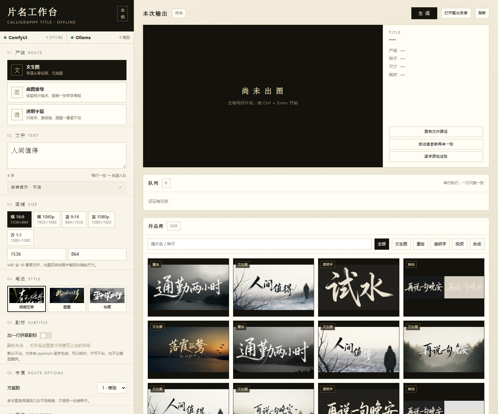

# 片名工作台（可选）

一个跑在本机的单页工作台，把 `src/` 的命令行能力包成可视化界面。**不联网、不上传、只监听 127.0.0.1**。

## 启动

```bash
python workbench/server.py
# 浏览器自动打开 http://127.0.0.1:8790
```

Windows 可双击 `start.bat`（后台常驻，关掉控制台也不影响）；`stop.bat` 停止 8790–8799 上的工作台进程。

## 能做什么

- 三条产线并排：文生图、底图重绘、透明字层
- 一行一句批量入队，队列串行执行，显存不打架
- 拼音先核对再出图，避免多音字错读
- 本机历史成图的作品库：搜索、预览、续画（数量取决于 `SAVE_DIR`）
- ComfyUI / Ollama 状态灯，卡死时可一键重启
- 上传底图、查看任务日志、失败重试



## 路径

- 默认 `TG_SKILL_ROOT` = 仓库根目录；也可指向已安装的 skill 目录
- 成图目录沿用 `src/config.py` 的 `SAVE_DIR`，可用 `TG_SAVE_DIR` 覆盖
- 运行数据在 `workbench/jobs.json`、`workbench/logs/`、`workbench/uploads/`，已被 `.gitignore` 忽略

## 排障

- 打不开：先看 `workbench/logs/server.err`；8790–8799 被占时服务会自动换端口，终端会打印实际地址
- 灯一直红：`python src/preflight.py` 看缺什么；或在界面点“重启 ComfyUI”
- 任务卡住：多为 CUDA sticky error，需要杀 ComfyUI 进程重启，单纯重试无效

## 许可

与仓库一致，Apache-2.0。工作台只是本地壳，不改变模型许可边界。
